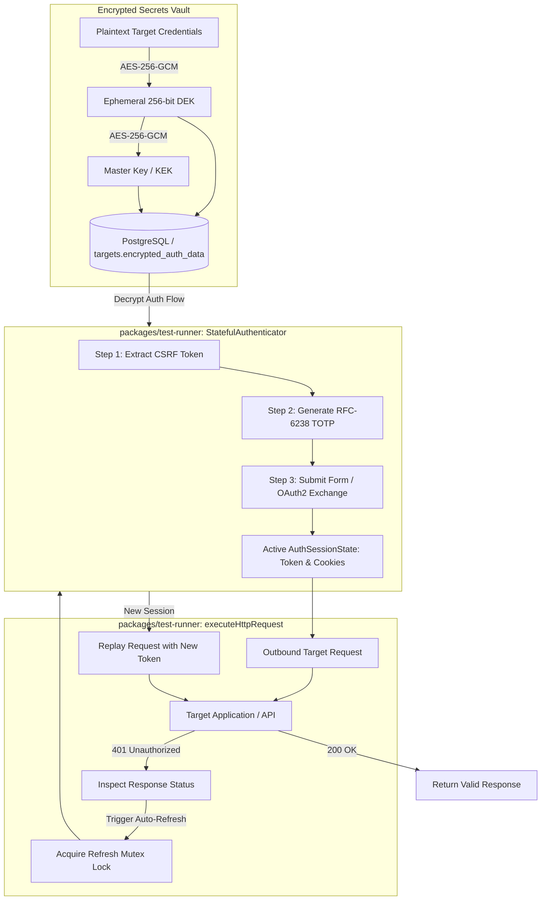

# Architecture: Stateful Authentication Workflows & Secrets Vault Integration

## 1. Architectural Overview

The Security & Resilience Testing Platform executes automated offensive and resilience security scans against customer targets. Many targets require authenticated sessions (e.g. administrative portals, single-page web applications, and secured APIs). 

Phase 06 introduces two foundational pillars:
1. **Cryptographic Envelope Encryption (`packages/crypto`)**: Sensitive target credentials (passwords, API tokens, TOTP seeds, private keys) are encrypted at rest with AES-256-GCM using ephemeral Data Encryption Keys (DEKs) wrapped by a platform Master Key (KEK).
2. **Stateful Authenticator & Auto-Refresh (`packages/test-runner`)**: Dynamic multi-step authentication orchestration supporting form logins with CSRF token extraction, RFC-6238 TOTP generation, OAuth2 flows, and automatic token refresh upon receiving HTTP 401 Unauthorized responses.



---

## 2. Envelope Encryption Architecture (`packages/crypto`)

### 2.1 AES-256-GCM Specification
- **Algorithm**: `AES-256-GCM` (Galois/Counter Mode).
- **IV Size**: 96 bits (12 bytes) cryptographically random IV generated per encryption.
- **Auth Tag**: 128 bits (16 bytes) authentication tag ensuring ciphertext integrity and authenticity.
- **DEK Generation**: 256 bits (32 bytes) cryptographically secure random bytes generated per encryption operation.
- **Payload Schema (`EncryptedPayload`)**:
  ```ts
  export interface EncryptedPayload {
    algorithm: 'aes-256-gcm';
    encryptedData: string; // Base64 ciphertext of plaintext payload
    iv: string;            // Base64 96-bit IV for plaintext encryption
    tag: string;           // Base64 128-bit authentication tag for data
    encryptedDek: string;  // Base64 ciphertext of DEK encrypted with Master Key
    dekIv: string;         // Base64 96-bit IV for DEK encryption
    dekTag: string;        // Base64 128-bit authentication tag for DEK
    keyId?: string;        // Optional key identifier for rotation
  }
  ```

### 2.2 Master Key Resolution
Master encryption keys are resolved dynamically:
1. Environment Variable: `SECURITY_LAB_MASTER_KEY` (32-byte hexadecimal string or base64).
2. Fallback Mode: For local CLI operations (`--local`) and automated unit/integration tests (`NODE_ENV === 'test'`), a deterministic local development key is generated in-memory.
3. Production Safety: In production environments without `--local`, the platform throws an immediate initialization exception if `SECURITY_LAB_MASTER_KEY` is omitted.

---

## 3. Database Schema & Migration (`014_encrypted_target_credentials.sql`)

Sensitive credentials are stored strictly in the `encrypted_auth_data` JSONB column on the `targets` table:

```sql
ALTER TABLE targets
  ADD COLUMN IF NOT EXISTS encrypted_auth_data JSONB;

CREATE INDEX IF NOT EXISTS idx_targets_encrypted_auth
  ON targets USING gin (encrypted_auth_data)
  WHERE encrypted_auth_data IS NOT NULL;

CREATE OR REPLACE VIEW target_profiles AS SELECT * FROM targets;
```

### 3.1 Zero Plaintext Exposure (Rule 4 & Objective 15)
- Target profile API write endpoints accept sensitive credentials (`authFlow`), encrypt them immediately using `encryptObject()`, and persist only the `EncryptedPayload`.
- Target profile API read endpoints never return the decrypted secrets or the raw encrypted DEKs. The API responds with `authConfigured: true` and high-level auth flow metadata.
- Internal test runners decrypt credentials in memory using `TargetsService.getDecryptedAuthData()` only during active job execution.

---

## 4. Stateful Multi-Step Authentication (`packages/test-runner`)

### 4.1 Form Login with CSRF & RFC-6238 TOTP
The `StatefulAuthenticator` executes sequential authentication steps:
1. **CSRF Extraction**:
   - Fetches the login page or CSRF endpoint via `GET`.
   - Extracts CSRF tokens from JSON bodies (`BODY_JSON`), HTML regexes (`BODY_REGEX`), or response headers/cookies (`HEADER`, `COOKIE`).
   - Automatically propagates the CSRF token into downstream step templates (`{{_csrf}}`).
2. **Dynamic TOTP Computation**:
   - If `totpSecret` is provided (RFC-6238 Base32 seed), the authenticator computes the current 6-digit TOTP code using HMAC-SHA1 and 30-second time steps.
   - Injects the generated code as `{{totp}}` into the form payload.
3. **Session State Extraction**:
   - Extracts session cookies from `Set-Cookie` headers.
   - Extracts JWT or bearer tokens from JSON response fields or `Authorization` headers.

### 4.2 OAuth2 Workflows
- **Client Credentials Grant**: `POST` to `tokenUrl` with `grant_type=client_credentials`, `client_id`, and `client_secret`.
- **Resource Owner Password Grant**: `POST` to `tokenUrl` with `grant_type=password`, `username`, and `password`.
- Tracks `expires_in` to proactively detect token expiration prior to request dispatch.

---

## 5. Automatic Token Refresh on 401 Unauthorized

Long-running test plans frequently exceed token expiration windows (e.g. 15-minute JWT lifetimes). 

In `packages/test-runner/src/executor.ts`:
```ts
// Intercept 401 Unauthorized for automatic token refresh & request retry
if (
  response.status === 401 &&
  options.authenticator &&
  options.autoRefresh !== false &&
  !hasRetriedAuth
) {
  hasRetriedAuth = true;
  await options.authenticator.refreshSession();
  const refreshedHeaders = options.authenticator.getHeaders();
  // Merge updated Authorization and Cookie headers
  currentHeaders = updateHeaders(currentHeaders, refreshedHeaders);
  continue; // Replay request
}
```

### 5.1 Concurrency Mutex Locking
When multiple concurrent requests experience token expiration simultaneously:
- `authenticator.refreshSession()` acquires an internal promise lock.
- All concurrent callers await the single in-flight re-authentication promise.
- Prevents authentication storms and account lockouts against target identity providers.

### 5.2 Infinite Loop Defense
- The request execution loop tracks `hasRetriedAuth = true`.
- If a target endpoint continues returning 401 even after re-authentication (e.g. insufficient user permissions), the 401 status is returned directly to the caller, preventing infinite retry loops.

---

## 6. Sensitive Header Redaction

In accordance with **Architecture Rule 4**, all outbound and inbound headers containing sensitive authorization information:
- `Authorization`
- `Proxy-Authorization`
- `Cookie` / `Set-Cookie`
- `X-Api-Key` / `Api-Key`

are masked as `***REDACTED***` via `redactHeaders()` and `redactObject()` before logging to structured logs or persisting finding evidence.
