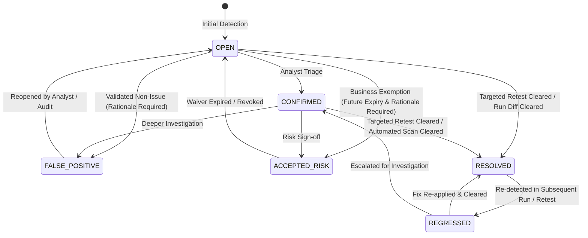

# Vulnerability Finding Lifecycle Intelligence, Retesting & Flapping Detection

## Overview
This document specifies the architecture and state machines governing vulnerability finding lifecycles, targeted single-finding verification (retesting), and historical run-over-run flapping analytics within the Security & Resilience Testing Platform.

---

## 1. Vulnerability Finding Lifecycle State Machine

The finding state machine governs vulnerability status transitions from discovery through remediation, triage, and regression detection.

### Transition Validation Rules
| From State | Allowed Target States | Required Invariants |
| :--- | :--- | :--- |
| `OPEN` | `CONFIRMED`, `RESOLVED`, `FALSE_POSITIVE`, `ACCEPTED_RISK`, `IGNORED` | Valid transition |
| `CONFIRMED` | `RESOLVED`, `FALSE_POSITIVE`, `ACCEPTED_RISK`, `IGNORED`, `OPEN` | Valid transition |
| `REGRESSED` | `RESOLVED`, `CONFIRMED`, `FALSE_POSITIVE`, `ACCEPTED_RISK`, `OPEN` | Re-verification |
| `FALSE_POSITIVE` | `OPEN`, `CONFIRMED` | Re-opening finding |
| `ACCEPTED_RISK` | `OPEN`, `CONFIRMED`, `RESOLVED` | Exemption revoked or fixed |
| `RESOLVED` | `OPEN`, `CONFIRMED`, `REGRESSED` | Regression or re-evaluation |

### Mandatory Invariants
1. **False Positive Rationale**: Setting `status = 'false_positive'` strictly requires a non-empty `comment` explaining why the detection is invalid.
2. **Accepted Risk Governance**: Setting `status = 'accepted_risk'` strictly requires both:
   - A non-empty `comment` detailing the business justification.
   - An ISO timestamp `expiresAt` in the future.
3. **Audit History Tracking**: Every status transition automatically appends an immutable entry to `triage_history` (`id`, `fromStatus`, `toStatus`, `timestamp`, `actorId`, `comment`, `expiresAt`) and logs an audit event to the `audit_events` table.

---

## 2. Targeted Single-Finding Retesting Engine

Re-running complete multi-stage test plans to verify a one-line bug fix creates unnecessary latency and consumes agent compute. The **Targeted Retester Service** (`apps/controller/src/services/retester.ts`) reconstructs minimal, isolated execution contexts for immediate verification.

### Retest Workflow
1. **Request Ingestion**: The developer triggers `POST /api/v1/findings/:id/retest`.
2. **Component Extraction**:
   - `extractFindingComponents(finding)` extracts `ruleOrCweId`, `endpointPath`, and `parameterName`.
   - The engine ID is extracted from `finding.testDefinitionId`.
3. **Synthetic Ephemeral Execution**:
   - An ephemeral single-engine execution is dispatched against `finding.target` with targeted options.
   - A strict 5-second timeout constraint is enforced for native rules via an `AbortController`.
4. **Resolution or Regression**:
   - **Flaw Cleared**: If the target rule no longer triggers, the finding transitions to `RESOLVED`, updating `fixedAt` and `fixedInRunId`.
   - **Flaw Still Detected**: If previously resolved, status transitions to `REGRESSED`. If open, remains open and reports `REOPENED`.
   - **Timeout Handling**: If execution exceeds the timeout, the status remains untouched, logging a warning to prevent false resolutions.

---

## 3. Historical Flapping Detection & CI/CD Release Gate Waiver

Network jitter, intermittent downstream outages, or unstable test environments can cause findings to intermittently oscillate between detected and resolved across sequential CI/CD builds (flapping). This causes alert fatigue and erodes team confidence.

### Flapping Score Formula
The **Flapping Service** (`apps/controller/src/services/flapping.ts`) analyzes the historical presence of the finding's fingerprint across the last $N \le 10$ test runs for that target:

$$\text{FlappingScore} = \frac{\text{State Transitions}}{\text{Total Runs}}$$

Where:
- $\text{Total Runs}$: Number of completed runs analyzed ($N \le 10$). If $\text{Total Runs} < 2$, $\text{FlappingScore} = 0.0$.
- $\text{State Transitions}$: Number of consecutive run pairs where the finding transitioned between `PRESENT` and `ABSENT`.

### Release Gate Suppression
- If $\text{FlappingScore} > 0.4$, the finding is tagged with `is_flapping = true` and metadata tag `UNSTABLE_FLAPPING`.
- In `packages/policy-engine/src/index.ts`, `evaluatePolicy()` inspects `isFlapping` or tag `UNSTABLE_FLAPPING`.
- Flapping findings are suppressed from failing release gates (`action: 'block_release'`), downgrading the check to an informational warning (`action: 'warn'`).

---

## 4. API Endpoints

| Method | Path | Role | Description |
| :--- | :--- | :--- | :--- |
| `POST` | `/api/v1/findings/:id/retest` | `ENGINEER` | Executes isolated single-rule retest and updates finding status. |
| `POST` | `/api/v1/findings/:id/triage` | `ENGINEER` | Updates finding triage state machine with validation and audit comment. |
| `GET` | `/api/v1/findings/:id/flapping` | `AUDITOR` | Returns run-over-run flapping analysis and historical state timeline. |
| `GET` | `/api/v1/findings?isFlapping=true` | `AUDITOR` | Lists findings filtered by flapping instability. |
