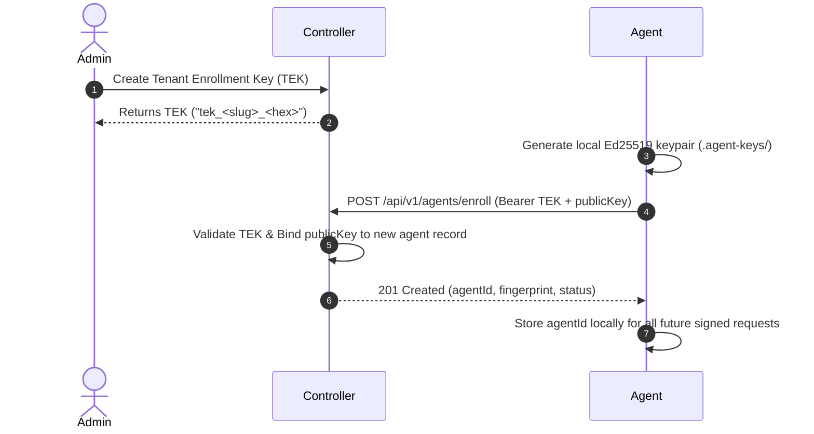

# Enterprise Private Agent Fleet Management & Asymmetric Cryptographic Attestation

## 1. Executive Summary & Zero-Trust Architecture
In distributed enterprise deployments, private runner agents operate across firewalled VPCs, on-premises datacenters, and isolated cloud enclaves. Historically, distributed systems relied on shared symmetric secrets (HMAC) to sign requests. If an attacker breached a single agent host in a remote DMZ, they could impersonate any fleet agent, steal cross-tenant jobs, or forge vulnerability reports.

Phase 15 replaces shared symmetric secrets with **per-agent asymmetric cryptographic attestation**, **capability-based routing**, **mutual TLS (mTLS)**, and **OpenTelemetry distributed tracing**.

```
+-----------------------------------------------------------------------------------+
|                            CONTROL PLANE (Controller)                             |
|                                                                                   |
|  +------------------------+    +-----------------------+    +------------------+  |
|  |  Agent Registry (DB)   |    |  Dispatcher Service   |    | Prometheus /     |  |
|  |  - public_key (Ed25519)|    |  - SELECT FOR UPDATE  |    | OpenTelemetry    |  |
|  |  - fingerprint (SHA256)|    |    SKIP LOCKED        |    | - /metrics       |  |
|  |  - tags & capabilities |    |  - required_tags <@   |    | - traceparent    |  |
|  +------------------------+    +-----------------------+    +------------------+  |
+------------------------------------------^----------------------------------------+
                                           |
                    Mutual TLS (HTTPS) / Ed25519 Signed HTTP
                     - X-Agent-Id: <uuid>
                     - X-Agent-Timestamp: <ms>
                     - X-Agent-Signature: <base64>
                     - traceparent: 00-<traceId>-<spanId>-01
                                           |
+------------------------------------------v----------------------------------------+
|                          REMOTE AGENT (Private Runner)                            |
|                                                                                   |
|  +--------------------------------+       +------------------------------------+  |
|  | Local Ed25519 Keypair          |       | Agent Daemon & Client              |  |
|  | - agent_private.key (mode 0600)|       | - Auto-enrollment via TEK          |  |
|  | - agent_public.pem  (mode 0644)| ----> | - Per-request canonical signing    |  |
|  | - Local key never leaves host  |       | - Anti-replay timestamp enforcement|  |
|  +--------------------------------+       +------------------------------------+  |
+-----------------------------------------------------------------------------------+
```

---

## 2. Asymmetric Cryptographic Attestation (Ed25519)

### 2.1 Keypair Generation & Storage
On first daemon initialization, the agent dynamically generates a high-entropy Ed25519 keypair:
- **Algorithm**: Ed25519 (RFC 8032)
- **Public Key**: SubjectPublicKeyInfo (SPKI) PEM
- **Private Key**: PKCS#8 PEM
- **Storage**:
  - `agent_private.key`: Restricted filesystem mode `0600` (read/write by owner only). The private key **never** leaves the runner filesystem.
  - `agent_public.pem`: Standard mode `0644`.

### 2.2 Key Fingerprint
Public keys are fingerprinted via SHA-256:
```ts
fingerprint = sha256(publicKeyPem.trim().replace(/\r\n/g, '\n'))
```
This 64-character hexadecimal digest provides non-repudiation and quick index lookups in the controller database.

---

## 3. One-Time Agent Enrollment Workflow



1. **Token Generation**: The tenant administrator generates a Tenant Enrollment Key (`TEK`) from the Control Plane API.
2. **Keypair Generation**: The agent boots and inspects its configured `AGENT_KEY_DIR`. If no keypair exists, it generates `agent_private.key` and `agent_public.pem`.
3. **Enrollment Request**: The agent submits an enrollment payload to `POST /api/v1/agents/enroll`:
   ```json
   {
     "name": "dmz-runner-node-01",
     "publicKey": "-----BEGIN PUBLIC KEY-----\nMCowBQYDK2VwAyEA...\n-----END PUBLIC KEY-----",
     "tags": ["vpc-internal", "docker-enabled", "high-memory"],
     "capabilities": ["engine-native-headers", "engine-zap"],
     "systemInfo": {
       "os": "linux",
       "arch": "x64",
       "cpuCount": 16,
       "totalMemoryMb": 32768
     }
   }
   ```
4. **Binding**: The controller validates the TEK, permanently associates the public key and fingerprint with the agent ID, and marks `auth_mode = 'asymmetric'`.

---

## 4. Per-Request Cryptographic Signing & Anti-Replay Protection

Every HTTP request dispatched by the agent (`/heartbeat`, `/poll`, `/jobs/:id/progress`, `/jobs/:id/complete`) is signed using the local private key.

### 4.1 Canonical Request Format
```
METHOD:PATH:TIMESTAMP:BODY_HASH
```
- `METHOD`: Uppercase HTTP verb (`GET`, `POST`).
- `PATH`: Clean URL path without query strings (e.g., `/api/v1/agents/heartbeat`).
- `TIMESTAMP`: Milliseconds since UNIX epoch (`Date.now()`).
- `BODY_HASH`: SHA-256 hexadecimal hash of the JSON body string, or empty string `""` if no body.

### 4.2 HTTP Request Headers
```http
POST /api/v1/agents/heartbeat HTTP/1.1
Host: controlplane.internal:4000
Content-Type: application/json
X-Agent-Id: 550e8400-e29b-41d4-a716-446655440000
X-Agent-Timestamp: 1728876000000
X-Agent-Signature: rU7wKzQx9p...<base64>...==
traceparent: 00-4bf92f3577b34da6a3ce929d0e0e4736-00f067aa0ba902b7-01
```

### 4.3 Anti-Replay Protection
The controller enforces a strict 60-second time drift window:
```ts
if (Math.abs(Date.now() - Number(timestamp)) > 60000) {
  throw new Error('REPLAY_ATTACK_DETECTED: Request outside 60s window');
}
```
Any intercepted request replayed after 60 seconds is automatically rejected with HTTP 401.

---

## 5. Capability-Based Job Routing

Agents declare static and dynamic capability tags upon enrollment and heartbeat:
```json
["vpc-internal", "docker-enabled", "pci-dss-enclave"]
```

When scheduling scans, test plans specify `required_tags`:
```sql
SELECT id FROM agent_jobs
WHERE tenant_id = $1
  AND status = 'queued'
  AND (required_tags <@ $agent_tags::jsonb OR required_tags = '[]'::jsonb)
FOR UPDATE SKIP LOCKED;
```
If a job requires `["pci-dss-enclave"]`, only agents carrying that tag will be leased the job. Standard agents will ignore the job atomically without lock contention.

---

## 6. Mutual TLS (mTLS) Deployment Guide

For high-security environments, mTLS encrypts transport and authenticates client certificates at the TLS handshake layer before any HTTP parsing occurs.

### 6.1 Environment Variables
| Variable | Component | Description |
|---|---|---|
| `MTLS_ENABLED` | Controller & Agent | Set to `true` to enforce mutual TLS |
| `MTLS_CA_CERT` | Controller & Agent | Path or PEM string of trusted Root CA certificate |
| `MTLS_SERVER_CERT` | Controller | Path or PEM string of Controller certificate |
| `MTLS_SERVER_KEY` | Controller | Path or PEM string of Controller private key |
| `MTLS_CLIENT_CERT` | Agent | Path or PEM string of Agent client certificate |
| `MTLS_CLIENT_KEY` | Agent | Path or PEM string of Agent client private key |

---

## 7. OpenTelemetry & Prometheus Observability

### 7.1 Distributed Tracing
All agent-controller requests carry W3C Trace Context (`traceparent` header). Spans in the agent correlate directly with execution traces in the controller.

### 7.2 Prometheus Metrics (`/metrics`)
The controller exposes Prometheus metrics on `GET /metrics`:
- `security_lab_agent_heartbeat_status{agent_id="...",tenant_id="...",status="..."}`: Heartbeat gauge (1=active).
- `security_lab_active_leases{agent_id="...",tenant_id="..."}`: Number of active job leases.
- `security_lab_jobs_leased_total`: Total counter of leased jobs.
- `security_lab_jobs_completed_total`: Total counter of completed jobs.
- `security_lab_jobs_failed_total`: Total counter of failed jobs.

---

## 8. Troubleshooting & Operational Runbook

### Issue: `REPLAY_ATTACK_DETECTED` (HTTP 401)
- **Cause**: Clock drift between the Agent host and Control Plane host exceeds 60 seconds.
- **Resolution**: Ensure NTP or `systemd-timesyncd` is synchronized on both hosts:
  ```bash
  chronyc tracking
  timedatectl status
  ```

### Issue: `INVALID_SIGNATURE` (HTTP 401)
- **Cause**: Request body or headers were modified by a reverse proxy or intermediary.
- **Resolution**: Verify that reverse proxies do not mutate request body formatting or URL paths. Verify agent is signing with the matching private key corresponding to its registered public key.

### Issue: `MISSING_PUBLIC_KEY` (HTTP 401)
- **Cause**: Agent was registered via legacy token flow without providing an asymmetric public key.
- **Resolution**: Re-enroll the agent using `POST /api/v1/agents/enroll` with the public key.
