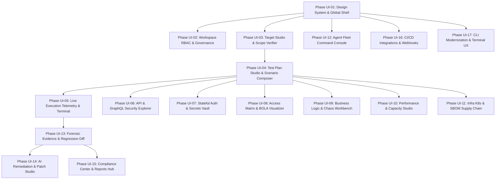

# Client Apps, UI & UX Modernization Roadmap
## Transforming the Security & Resilience Testing Platform into an Enterprise-Grade Cyber Operations Console

**Document Type:** Master Client Apps, UI & UX Product Roadmap & Technical Architecture  
**Target Applications:** `@security-lab/dashboard` (Web SPA), `@security-lab/cli` (Terminal CLI), `@security-lab/reporter` (Interactive Offline HTML & PDF Exports)  
**Status:** Approved for Implementation  
**Backend Baseline:** 21 Verified Backend & Engine Phases (65 Test Suites, 822 Passing Tests)  
**Target Design Standard:** SOC Dark Glassmorphism, Sub-Second Telemetry, Micro-Interactions, Zero-Ambiguity Forensic Verification  

---

## 1. Executive Summary & Reality Audit

### 1.1 Current Baseline Reality
Across Phases 01 through 21, the backend platform has achieved complete feature maturity:
- **Core RBAC & Workspaces** (Phase 01)
- **Target Scope, Ownership & DNS Pinning** (Phase 02)
- **Engine SDK Worker Sandboxing** (Phase 03)
- **Web DAST Crawler & Dynamic Injection** (Phase 04)
- **API Security, GraphQL Introspection & Schema** (Phase 05)
- **Stateful Auth & Secrets Vault** (Phase 06)
- **BOLA / BFLA Matrix & Access Graph** (Phase 07)
- **Business Logic State Machines** (Phase 08)
- **Native Performance & Capacity Engineering** (Phase 09)
- **Chaos Fault Injection & Resilience** (Phase 10)
- **Traffic Routing & Request Smuggling** (Phase 11)
- **Database Protocol Security** (Phase 12)
- **Kubernetes & Cloud Infrastructure Audit** (Phase 13)
- **SBOM & Software Supply Chain** (Phase 14)
- **Enterprise Agent Fleet & mTLS** (Phase 15)
- **Finding Lifecycle, Retesting & Flapping** (Phase 16)
- **Compliance Reporting (OWASP/ASVS) & PDF** (Phase 17)
- **Operations Console Foundation** (Phase 18)
- **CI/CD Integrations & Webhooks** (Phase 19)
- **AI Remediation & Patch Verification** (Phase 20)
- **Multi-Tenant SaaS Control Plane & Governance** (Phase 21)

### 1.2 The Client Experience Deficit
While the backend has full REST/SSE endpoints and 822 tests verifying deep security and resilience capabilities, the user interface (`apps/dashboard`) and developer CLI (`apps/cli`) currently expose only a fraction of these capabilities:
1. **Fragmented Navigation**: The dashboard only has 6 high-level tabs (`overview`, `targets`, `runs`, `findings`, `policies`, `management`), with over 15 critical engines and governance features crammed into unsegmented forms or omitted entirely.
2. **Missing Deep Workbenches**: Operators have no visual interface for GraphQL introspection graphs, BOLA access matrices, chaos fault-injection sliders, state machine bypass graphs, or SBOM dependency trees.
3. **No Visual Test Plan Studio**: Test runs must be triggered with raw JSON payloads or basic engine toggles rather than an interactive node/sequence plan builder with pre-flight safety validation.
4. **Disjointed AI & Remediation UX**: AI remediation exists in an API route and basic modal, but lacks a side-by-side Monaco code diff editor, patch tester, and GitHub PR creation flow.
5. **Disconnected Multi-Tenancy & SSO**: Organization switcher, SAML/OIDC SSO setup wizard, SCIM synchronization logs, and Stripe quota meters lack a dedicated governance interface.
6. **CLI Ergonomics**: The CLI lacks modern interactive setup wizards (`security-lab init`, `security-lab target verify`), spinners, colored in-terminal diffs, and SARIF terminal summaries.

---

## 2. Design System & Visual Philosophy

### 2.1 Aesthetic Language: "Obsidian Cyber Ops"
The client apps must deliver an immediate feeling of military-grade precision, authority, and tactical clarity:
- **Palette**: Deep Obsidian background (`#090d16`), Slate Charcoal panels (`#0f172a`), Dark Navy cards (`#1e293b`), with border definitions in subtle translucent zinc (`rgba(255, 255, 255, 0.08)`).
- **Accents**: Electric Cyan (`#00e5ff`) for primary interactive states, Neon Cobalt (`#3b82f6`) for information telemetry, Emerald Glow (`#10b981`) for passing gates & resolved items, Amber Flame (`#f59e0b`) for warnings & waivers, Crimson Hazard (`#ef4444`) for critical vulnerabilities and circuit breaker trips, and Purple Quantum (`#a855f7`) for AI remediation engine.
- **Typography**: Inter for clean, legible interface text; JetBrains Mono with tabular numbers for IP addresses, hashes, payloads, cURL snippets, and status codes.
- **Atmosphere**: Subtle 16px backdrop blurs (Glassmorphism), animated live status pulses (radar sweep, pulse rings for active agents, streaming terminal scanlines).
- **Haptic & Visual Feedback**: Fluid transitions (150-200ms ease-out), micro-interactions on hover/focus, distinct status badges, and copy-to-clipboard confirmation ripples.

### 2.2 Global Ergonomics & Navigation
- **Command Palette (`Ctrl+K` / `Cmd+K`)**: Instant universal search across targets, runs, findings, CVEs, agents, and quick actions ("Trigger Scan", "Add Target", "Verify Scope", "Export PDF Report").
- **Universal Organization & Workspace Switcher**: Fixed header dropdown with active tenant indicator, role badge (`Admin`, `Security Engineer`, `Auditor`), and quick switch without page reload.
- **Persistent Telemetry Strip**: Controller connectivity status, active worker fleet count, active run counter, and security alert ticker.
- **Zero-Ambiguity Status Representations**: Explicit visual differentiation between `Verified Exploit`, `Potential Risk`, `Inconclusive / Timeout`, and `False Positive`.

---

## 3. UI/UX Feature Family Mapping (Phases 01 - 21)

| Phase | Backend Capability Delivered | Required UI / UX Capability in Client Apps |
|---|---|---|
| **Phase 01** | Workspaces, Projects, RBAC Roles, Audit Logs | Organization/Workspace switcher, Team Member invites, Granular Role Matrix modal, Immutable Audit Log viewer |
| **Phase 02** | DNS Pinning, Ownership Proofs, Safety Budgets | Interactive Ownership Challenge Wizard (DNS TXT / HTTP token check), CIDR & Port scope builder, live Safety Budget gauge |
| **Phase 03** | Engine SDK Sandboxing, Telemetry | Engine Catalog & Health Matrix, Worker memory/CPU gauges, Execution sandbox flags |
| **Phase 04** | Web DAST Crawler, Dynamic Injection | Discovered Site-Map tree viewer, dynamic form inspector, live injection payload activity log |
| **Phase 05** | API & GraphQL Security, Schema Conformance | OpenAPI 3.0 drag-and-drop viewer, GraphQL Schema Introspection explorer, circular query depth limiter slider |
| **Phase 06** | Stateful Auth, Secrets Vault (AES-256-GCM) | Visual Auth Flow recorder & step simulator, Credential Vault with zero-knowledge masked fields, TOTP seed QR/key entry |
| **Phase 07** | BOLA / BFLA Matrix & Access Graph | Identity A vs. Identity B Access Matrix Heatmap, vertical/horizontal privilege escalation graph |
| **Phase 08** | Business Logic State Machine, Race Conditions | State Machine Flowchart visualizer (valid paths vs bypasses), Concurrency Race-Condition burst analyzer |
| **Phase 09** | Native Performance Engineering, Capacity | Real-time RPS throughput waterfall, Latency Distribution Histogram (p50, p90, p95, p99), Saturation Point detector |
| **Phase 10** | Chaos MITM Fault Injection & Resilience | Chaos Workbench: Latency injection slider, Packet Drop toggle, 500/503 error injector, Circuit Breaker trip visualizer |
| **Phase 11** | Request Smuggling (CL.TE / TE.CL / TE.TE) | Smuggling Desync Wire Inspector: Side-by-side frontend vs backend parsed HTTP request frame diffs |
| **Phase 12** | Database Protocol Security (PG, MySQL, Redis) | Database Security Target tab: Wire auth test results, connection pool stress meters, slow-query saturation graphs |
| **Phase 13** | Kubernetes & Cloud-Native Security Audit | K8s Cluster/Namespace/Workload tree, Pod Security Standard scorecards (Privileged, Baseline, Restricted) |
| **Phase 14** | Software Supply Chain SBOM & Vulnerabilities | Interactive Dependency Graph, CycloneDX/SPDX upload & viewer, OSV/NVD CVE cards, License compliance matrix |
| **Phase 15** | Private Agent Fleet & mTLS Attestation | Agent Command Console: Fleet radar map, mTLS certificate status, heartbeat telemetry, job lease claims |
| **Phase 16** | Finding Lifecycle, Retesting & Flapping | Run-over-Run Diffing Console ("New", "Resolved", "Flapping"), SLA countdown timers, single-finding 1-click retest |
| **Phase 17** | Compliance Reports (OWASP/ASVS) & PDF 1.4 | Compliance Scorecard Dashboard, real-time PDF/HTML report previewer, one-click SARIF 2.1 export |
| **Phase 18** | Operations Console & Event Streaming | Full-screen live SSE execution terminal with auto-scroll, log filter, stage pipeline progress graph |
| **Phase 19** | CI/CD Integrations, Webhooks, GitHub/Jira Sync | Webhook Manager (HMAC key, test ping, retry history), GitHub/Jira 2-way sync cards, GitHub Actions YAML generator |
| **Phase 20** | AI-Assisted Remediation & Verification | AI Remediation Studio: Side-by-side Monaco code diff, root-cause checklist, automated patch verification status |
| **Phase 21** | Multi-Tenant SaaS Control Plane & Billing | SSO Config Wizard (SAML 2.0 / OIDC), SCIM 2.0 sync log viewer, Stripe usage metering & subscription tiers |
| **CLI** | Developer Experience & Local Execution | Interactive Inquirer wizards, colored diffs, terminal spinners, SARIF terminal tables, pre-commit hook installer |

---

## 4. Master Client Apps Phased Implementation Schedule

The client app updates are organized into 17 autonomous, sequential phases:



---

## 5. Verification Protocol for Client App Updates

Each phase must satisfy the following quality gates before acceptance:
1. **Type Safety & Build Cleanliness**:
   ```powershell
   pnpm --filter @security-lab/dashboard build
   pnpm --filter @security-lab/cli build
   ```
   Zero TypeScript diagnostics, zero missing imports, zero bundle chunk warnings.
2. **Component & Integration Testing**:
   Unit tests using Vitest and React Testing Library verifying state transitions, form validations, SSE event parsing, and API error states.
3. **Responsive & Accessible UI**:
   Clean rendering across Desktop (1920x1080), Laptop (1366x768), and Mobile (375x812) viewports. Full keyboard navigation for modal dialogs and dropdowns.
4. **Monorepo Zero-Regression**:
   All 65 existing test suites (822 tests) in the controller, engines, and contracts must continue to pass cleanly.
