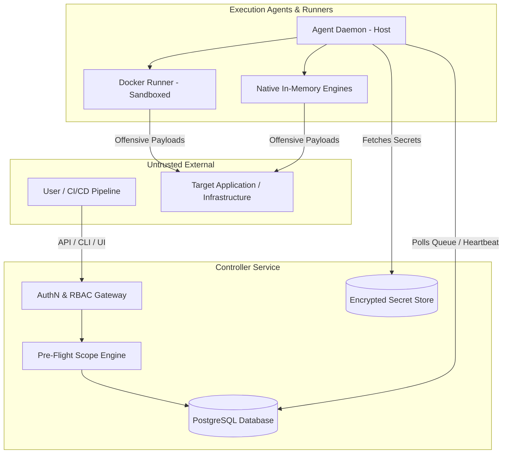

# Security & Reliability Gap Analysis

## 1. Executive Summary

This document provides a rigorous architectural evaluation of the security boundaries, safety controls, failure modes, and platform reliability invariants across the Security & Resilience Testing Platform. 

Because this platform executes offensive security scans, fuzzing payloads, and synthetic traffic generation, it presents a unique threat surface:
1. **Misdirection Risk**: The platform could be coerced into attacking unauthorized third-party infrastructure.
2. **Denial-of-Service Risk**: Overly aggressive scans or uncontrolled concurrency could crash customer production or staging environments.
3. **Privilege Escalation Risk**: Compromise of an execution agent or runner could expose target credentials, API tokens, or tenant findings.
4. **Execution Integrity Risk**: Tampering with findings, evidence, or release-gate evaluation could allow insecure code into production.

---

## 2. Threat Modeling & Security Boundaries

### 2.1 Primary Trust Boundaries
1. **Client to Controller Boundary**: API clients (CLI, Dashboard, CI/CD) authenticate via API keys or session tokens. Must enforce strict role-based access control (RBAC) and workspace isolation.
2. **Controller to Agent Boundary**: Distributed execution agents communicate with the controller over HTTPS. Currently authenticated via shared HMAC secret. Must transition to per-agent cryptographic attestation and mutual TLS (mTLS).
3. **Agent to Execution Runner Boundary**: Engines execute either as in-memory native code or within isolated Docker containers. Must enforce strict CPU, memory, socket, and filesystem quotas.
4. **Platform to Target Boundary**: Outbound scanning packets directed at user-specified targets. Must strictly enforce scope validation, rate limiting, and emergency abort controls.

---

## 3. High-Priority Security Gaps

### GAP-SEC-01: DNS Rebinding & TOCTOU Scope Bypass
- **Severity**: `CRITICAL (P0)`
- **Current Architecture**: The `ScopeEngine` performs static IP and CIDR validation at plan creation and job dispatch time (`packages/scope-engine/src/validator.ts`).
- **Failure Mode / Attack Scenario**: 
  1. User specifies an authorized domain `target.example.com` which resolves to public IP `203.0.113.50`.
  2. Scope engine validates that `203.0.113.50` is within allowed CIDR.
  3. After dispatch, an attacker changes DNS records for `target.example.com` to point to AWS metadata service `169.254.169.254` or internal database `10.0.0.5`.
  4. The engine executes HTTP requests using the OS DNS resolver, attacking internal infrastructure.
- **Required Architectural Fix**:
  - Implement a custom DNS resolver wrapper in `packages/scope-engine` and `packages/test-runner`.
  - Perform DNS resolution immediately prior to socket connection.
  - Pin the resolved IP address and verify it against scope constraints before establishing TCP connection.
  - Reject all addresses resolving to loopback (`127.0.0.0/8`), link-local (`169.254.0.0/16`), or private ranges unless private scan mode is explicitly authorized.

### GAP-SEC-02: Target Ownership & Authorization Proofs
- **Severity**: `HIGH (P1)`
- **Current Architecture**: Any user with project write access can define arbitrary targets (URLs, hostnames, CIDRs) without proving administrative control.
- **Failure Mode / Attack Scenario**:
  - A malicious or compromised tenant configures `https://competitor.com` as a target and triggers high-intensity DAST and load testing suites, using the platform as a distributed denial-of-service (DDoS) weapon.
- **Required Architectural Fix**:
  - Implement target verification challenges before enabling active scanning engines:
    - **DNS Challenge**: Verification of a `_security-lab-challenge` TXT record.
    - **HTTP Challenge**: Placement of an ephemeral token at `/.well-known/security-lab-challenge.txt`.
  - Non-verified targets are restricted to passive analysis or localhost/RFC-1918 internal lab networks.

### GAP-SEC-03: Shared HMAC Agent Identity vs. Per-Agent Cryptographic Attestation
- **Severity**: `HIGH (P1)`
- **Current Architecture**: All agents use a shared symmetric key (`AGENT_HMAC_SECRET`) to compute request signatures (`apps/agent/src/daemon.ts` and `apps/controller/src/plugins/auth.ts`).
- **Failure Mode / Attack Scenario**:
  - Compromise of a single agent host reveals the shared HMAC secret, allowing an adversary to impersonate any agent, steal test jobs across tenants, poison finding results, or falsify release gate evaluations.
- **Required Architectural Fix**:
  - Issue unique asymmetric key pairs or X.509 client certificates per agent.
  - Implement agent enrollment workflow with one-time registration tokens.
  - Controller validates signatures against the specific public key of the registered agent ID.

### GAP-SEC-04: Plaintext Target Credentials & Secrets in Database
- **Severity**: `HIGH (P1)`
- **Current Architecture**: Target authentication headers, bearer tokens, and basic auth credentials are stored in database JSON columns (`test_plans.configuration` or `target_profiles.headers`).
- **Failure Mode / Attack Scenario**:
  - A database read replica compromise or SQL injection exposes customer staging and production API keys and administrative credentials.
- **Required Architectural Fix**:
  - Implement an envelope encryption service (`packages/crypto`) using AES-256-GCM.
  - Target credentials must be encrypted at rest with a tenant-specific data encryption key (DEK) backed by a master key (KMS/Vault).
  - Credentials must only be decrypted in-memory by the assigned agent immediately prior to test dispatch.

---

## 4. Platform Reliability & Failure Modes

### GAP-REL-01: Target Degradation & Circuit Breaking
- **Severity**: `HIGH (P1)`
- **Current Architecture**: Test runners execute requests based on a configured rate limit, but lack dynamic backoff based on target health feedback.
- **Failure Mode**:
  - A target application begins thrashing or experiencing cascading database failures under load/fuzzing. The runner continues sending requests until the target crashes completely.
- **Required Architectural Fix**:
  - Implement an adaptive circuit breaker in `packages/test-runner`:
    - Track rolling window of response status codes and latencies.
    - If target emits > 25% 5xx responses (or connection timeouts) over 10 consecutive requests, immediately trip circuit breaker to `OPEN`.
    - Pause execution, log warning finding, and attempt single-probe canary requests before resuming or gracefully terminating test run.

### GAP-REL-02: Agent Zombie Leases & Stalled Job Recovery
- **Severity**: `MEDIUM (P1)`
- **Current Architecture**: The dispatcher uses PostgreSQL `FOR UPDATE SKIP LOCKED` to lease jobs (`apps/controller/src/services/dispatcher.ts`). Heartbeat updates `last_heartbeat_at`.
- **Verified Status**: Working for normal completion and timeout handling.
- **Failure Mode**:
  - If an agent process crashes (SIGKILL, host power failure, out-of-memory killer) midway through a test run, the leased job remains in `RUNNING` status until manual timeout intervention.
- **Required Architectural Fix**:
  - Add an automated reaper cron / background worker in the controller service.
  - Any job whose leasing agent has missed 3 consecutive heartbeat intervals (e.g., > 90 seconds) is automatically transitioned to `FAILED` with status reason `AGENT_HEARTBEAT_TIMEOUT`, releasing resources and alerting the project team.

### GAP-REL-03: Resource Sandboxing & Docker Runner Cleanup
- **Severity**: `MEDIUM (P1)`
- **Current Architecture**: Container runners (`engines/zap-dast`, `engines/trivy-scanner`, `engines/k6-load`) spawn Docker containers via `docker run`.
- **Failure Mode**:
  - If the agent daemon is terminated or encounters an unhandled exception, spawned Docker containers continue running in the background, consuming CPU/memory indefinitely and leaking disk space in `/tmp`.
- **Required Architectural Fix**:
  - Standardize container lifecycle in `packages/docker-runner`:
    - Apply mandatory container labels: `security-lab.job-id`, `security-lab.created-at`.
    - Apply resource limits: `--memory="2g" --cpus="2.0" --pids-limit=200 --security-opt=no-new-privileges:true`.
    - Daemon startup reconciles dangling containers matching label `security-lab` and terminates them.

---

## 5. Security & Reliability Invariant Checklist

| Invariant | Current State | Required Target State |
|---|---|---|
| **Zero Unauthorized Scanning** | Partial (static CIDR check) | Enforced via pre-socket DNS pinning + Ownership challenges |
| **Tamper-Evident Findings** | Verified (SHA256 fingerprinting) | Verified (Continuous cryptographic evidence sealing) |
| **Strict Process Isolation** | Partial (Docker runner has basic flags) | Enforced (no-new-privileges, unprivileged user, dropped capabilities) |
| **Secret Zero Exposure** | Scaffolded (Plaintext in DB) | Envelope encrypted at rest (AES-256-GCM) |
| **Safe Failure on Disruption** | Partial (Timeout exists) | Dynamic circuit breaker + Heartbeat reaper |
| **Local-First Safety** | Verified (CLI runs native in-memory) | Verified (Zero Docker/network dependency for native rules) |
