# Architecture Dependency Mapping

## 1. Monorepo Structural Dependency Hierarchy

The platform follows a strict layered monorepo architecture. Higher-level applications and services depend downward upon reusable packages and shared contracts. Circular dependencies between packages or back-references from packages to applications are strictly forbidden.

```mermaid
graph TD
    subgraph Layer 4: Applications
        CLI[apps/cli]
        Controller[apps/controller]
        Agent[apps/agent]
        Dashboard[apps/dashboard]
    end

    subgraph Layer 3: Native Engines & Runners
        Engines[engines/*]
        DockerRunner[packages/docker-runner]
    end

    subgraph Layer 2: Platform Core Packages
        EngineSDK[packages/engine-sdk]
        ScopeEngine[packages/scope-engine]
        Planner[packages/planner]
        TestRunner[packages/test-runner]
        PolicyEngine[packages/policy-engine]
        Reporter[packages/reporter]
        Crypto[packages/crypto (Planned)]
    end

    subgraph Layer 1: Contracts & Schema Base
        Contracts[packages/contracts]
    end

    CLI --> Contracts
    CLI --> EngineSDK
    CLI --> ScopeEngine
    CLI --> Planner
    CLI --> TestRunner
    CLI --> PolicyEngine
    CLI --> Reporter
    CLI --> Engines

    Controller --> Contracts
    Controller --> EngineSDK
    Controller --> ScopeEngine
    Controller --> Planner
    Controller --> PolicyEngine
    Controller --> Reporter

    Agent --> Contracts
    Agent --> EngineSDK
    Agent --> ScopeEngine
    Agent --> TestRunner
    Agent --> DockerRunner
    Agent --> Engines

    Dashboard --> Contracts

    Engines --> EngineSDK
    Engines --> Contracts

    EngineSDK --> Contracts
    ScopeEngine --> Contracts
    Planner --> Contracts
    TestRunner --> Contracts
    TestRunner --> ScopeEngine
    PolicyEngine --> Contracts
    Reporter --> Contracts
    DockerRunner --> Contracts
```

---

## 2. Cross-Subsystem Dependency Matrix

| Subsystem | Depends On (Hard Prerequisites) | Soft / Optional Dependencies | Consumed By |
|---|---|---|---|
| `packages/contracts` | None (pure TypeScript + Zod) | None | All apps, packages, and engines |
| `packages/scope-engine` | `packages/contracts` | Node `dns/promises` | `test-runner`, `cli`, `controller` |
| `packages/engine-sdk` | `packages/contracts` | None | All engines, `test-runner`, `cli`, `controller` |
| `packages/planner` | `packages/contracts` | None | `cli`, `controller` |
| `packages/test-runner` | `packages/contracts`, `packages/scope-engine`, `packages/engine-sdk` | None | `apps/cli`, `apps/agent` |
| `packages/docker-runner` | `packages/contracts` | Docker daemon | `engines/zap-dast`, `engines/trivy-scanner`, `engines/k6-load` |
| `packages/policy-engine` | `packages/contracts` | None | `apps/cli`, `apps/controller` |
| `packages/reporter` | `packages/contracts` | None | `apps/cli`, `apps/controller` |
| `apps/cli` | All Layer 1, 2, 3 packages | None | End-users, CI/CD runners |
| `apps/controller` | `packages/contracts`, `packages/planner`, `packages/policy-engine`, PostgreSQL | Redis (optional cache) | Dashboard, Agent daemon, CLI (remote) |
| `apps/agent` | `packages/contracts`, `packages/test-runner`, `packages/engine-sdk`, `engines/*` | Docker daemon | Controller queue |
| `apps/dashboard` | `packages/contracts` | React, Vite | End-users, Security managers |

---

## 3. Database Migration & Schema Sequence

Database migrations are executed sequentially using the migration runner in `apps/controller/src/db/migrate.ts`. New features must never alter historical migration files (`001` through `011`).

### 3.1 Migration Dependency Graph

```mermaid
graph LR
    001[001_initial_schema] --> 002[002_target_profiles]
    002 --> 003[003_test_plans]
    003 --> 004[004_test_runs]
    004 --> 005[005_findings]
    005 --> 006[006_evidence_artifacts]
    006 --> 007[007_agent_leases]
    007 --> 008[008_policies]
    008 --> 009[009_regression_snapshots]
    009 --> 010[010_indexes_and_perf]
    010 --> 011[011_finding_status_triage]
    011 --> M12[Planned: 012_workspaces_and_rbac]
    M12 --> M13[Planned: 013_target_ownership_challenges]
    M13 --> M14[Planned: 014_agent_keys_and_attestation]
    M14 --> M15[Planned: 015_encrypted_credentials]
```



### 3.2 Planned Migration Roadmap
1. `012_workspaces_and_rbac.sql`:
   - Adds `workspaces` table (`id`, `name`, `slug`, `created_at`).
   - Adds `workspace_members` table (`workspace_id`, `user_id`, `role`).
   - Adds `workspace_id` foreign key to `projects`.
2. `013_target_ownership_challenges.sql`:
   - Adds `ownership_verification_token`, `verification_type` (DNS/HTTP), `verified_at` to `target_profiles`.
3. `014_agent_keys_and_attestation.sql`:
   - Adds `public_key`, `key_fingerprint`, `enrollment_token`, `tags` to `agents` table.
4. `015_encrypted_credentials.sql`:
   - Modifies `target_profiles` and `test_plans` to store ciphertext and key derivation metadata for sensitive headers.

---

## 4. Local-First vs. Distributed Execution Boundaries

A primary design constraint is **zero-dependency local execution**:
- Developers must be able to run `security-lab run --local --plan test-plan.yaml` on a bare workstation with only Node.js installed.
- Native TypeScript engines (`headers`, `cors`, `tls`, `rate-limit`, `auth-testing`, `bola-testing`, `declarative-dsl`, `openapi-contract`) require zero external processes, no Docker, and no database.
- Container-based engines (`zap-dast`, `trivy-scanner`, `k6-load`) are conditionally enabled only if Docker is available.
- Distributed execution via `apps/agent` and `apps/controller` is an operational extension for team clusters, not a prerequisite for developer usage.

```mermaid
graph TD
    subgraph Developer Laptop (Local-First)
        DevCLI[CLI Tool]
        NativeEng[Native TS Engines]
        TargetApp[Localhost / Staging Target]
        DevCLI -->|In-Memory Direct Execution| NativeEng
        NativeEng -->|HTTP/TLS| TargetApp
    end

    subgraph Enterprise Cluster (Distributed)
        CI[CI/CD Workflow]
        Ctrl[Central Controller API]
        PG[(PostgreSQL State)]
        AgtCluster[Agent Fleet 1..N]
        DockerEng[Container Engines]
        CI --> Ctrl
        Ctrl --> PG
        AgtCluster -->|SKIP LOCKED Poll| PG
        AgtCluster --> DockerEng
        AgtCluster --> TargetApp
    end
```

---

## 5. Critical Shared Contract Invariants

All inter-subsystem data exchange occurs via types declared in `packages/contracts`. Breaking changes to these types will desynchronize the platform:

1. **`Finding` Schema**:
   - `id`: UUIDv4
   - `fingerprint`: SHA256 deterministic string
   - `ruleId`, `name`, `severity` (`INFO` | `LOW` | `MEDIUM` | `HIGH` | `CRITICAL`)
   - `status`: `OPEN` | `CONFIRMED` | `FALSE_POSITIVE` | `ACCEPTED_RISK` | `RESOLVED`
   - `target`: URL/Hostname
   - `evidence`: Structured request/response payload with SHA256 integrity hash.
2. **`ExecutionResult` Schema**:
   - `engineId`: String
   - `status`: `COMPLETED` | `FAILED` | `TIMEOUT` | `ABORTED`
   - `findings`: Array of `Finding`
   - `metrics`: Standard latency and request counters
3. **`TestPlan` Schema**:
   - `stages`: Sequential list of test execution steps
   - `stages[i].parallel`: Boolean flag controlling concurrency within stage
   - `stages[i].engines`: List of engine configurations
