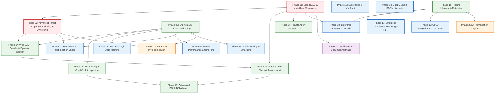

# Phase Dependency Graph & Execution Topology

## 1. Visual Dependency Graph

---

## 2. Textual Dependency Order & Execution Stages

For environments where Mermaid diagrams cannot be rendered, the implementation sequence is structured into five distinct execution tiers:

### Tier 1: Core Trust & Safety Foundations (Mandatory First Wave)
- **Phase 01: Core RBAC & Multi-User Workspaces** (`P0`)
  - *Hard Prerequisites*: None.
  - *Unlocks*: Phases 02, 06, 15, 18, 21.
  - *Rationale*: All user data, target ownership, and audit logs require workspace tenant keys.
- **Phase 02: Advanced Target Scope, DNS Pinning & Ownership Verification** (`P0`)
  - *Hard Prerequisites*: Phase 01.
  - *Unlocks*: Phases 04, 10, 12.
  - *Rationale*: High-intensity and offensive scanners cannot be executed against arbitrary external targets without pre-socket DNS pinning and verified ownership.
- **Phase 03: Engine SDK Worker Sandboxing & Dynamic Lifecycle** (`P1`)
  - *Hard Prerequisites*: Baseline monorepo contracts.
  - *Unlocks*: Phases 04, 05, 08, 09, 10, 11, 12.
  - *Rationale*: Provides the isolated worker thread execution harness required by all new native testing engines.

### Tier 2: Offensive & API Testing Foundations (Parallelizable Wave A)
- **Phase 04: Web Application DAST Crawler & Dynamic Injection Fuzzing** (`P1`)
  - *Hard Prerequisites*: Phase 02, Phase 03.
  - *Unlocks*: Phase 06.
- **Phase 05: API Security, GraphQL Introspection & Schema Conformance** (`P1`)
  - *Hard Prerequisites*: Phase 03.
  - *Unlocks*: Phase 07.
- **Phase 06: Stateful Authentication Flows & Secrets Vault Integration** (`P1`)
  - *Hard Prerequisites*: Phase 01, Phase 04.
  - *Unlocks*: Phase 07.
- **Phase 07: Automated BOLA / BFLA Matrix & Access Graph Evaluation** (`P1`)
  - *Hard Prerequisites*: Phase 05, Phase 06.
- **Phase 13: Kubernetes & Cloud-Native Infrastructure Security Audit** (`P2`)
  - *Hard Prerequisites*: Baseline contracts.
- **Phase 14: Software Supply Chain SBOM Lifecycle & Advisory Feeds** (`P2`)
  - *Hard Prerequisites*: Baseline contracts.

### Tier 3: Specialized Testing Engines & Fleet Hardening (Parallelizable Wave B)
- **Phase 08: Business Logic State Machine Testing & Race Conditions** (`P2`)
  - *Hard Prerequisites*: Phase 03.
- **Phase 09: Native Performance Engineering & Capacity Benchmarking** (`P2`)
  - *Hard Prerequisites*: Phase 03.
- **Phase 10: Resilience & Controlled Fault Injection (Chaos MITM)** (`P2`)
  - *Hard Prerequisites*: Phase 02, Phase 03.
- **Phase 11: Traffic Routing & HTTP Request Smuggling Verifier** (`P2`)
  - *Hard Prerequisites*: Phase 03.
- **Phase 12: Direct Database Protocol Security & Connection Resilience** (`P3`)
  - *Hard Prerequisites*: Phase 02, Phase 03.
- **Phase 15: Enterprise Private Agent Fleet Management & Mutual TLS** (`P1`)
  - *Hard Prerequisites*: Phase 01.

### Tier 4: Intelligence, Governance & Developer Experience
- **Phase 16: Finding Lifecycle Intelligence, Retesting & Flapping Detection** (`P1`)
  - *Hard Prerequisites*: Baseline finding services.
  - *Unlocks*: Phases 17, 18, 19, 20.
- **Phase 17: Enterprise Compliance Reporting (OWASP/ASVS) & PDF Export** (`P2`)
  - *Hard Prerequisites*: Phase 16.
- **Phase 18: Enterprise Operations Console & Interactive Triage Dashboard** (`P2`)
  - *Hard Prerequisites*: Phase 01, Phase 16.
  - *Unlocks*: Phase 21.
- **Phase 19: CI/CD Ecosystem Integrations, Webhooks & Issue Tracker Sync** (`P2`)
  - *Hard Prerequisites*: Phase 16.

### Tier 5: Enterprise Scale & Commercial Control Plane
- **Phase 20: AI-Assisted Security Analysis & Remediation Verification** (`P3`)
  - *Hard Prerequisites*: Phase 16.
- **Phase 21: Multi-Tenant SaaS Control Plane & Enterprise Governance** (`P4`)
  - *Hard Prerequisites*: Phase 01, Phase 18.

---

## 3. Parallel Execution Tracks for Multi-Agent / Multi-Team Development

Once Tier 1 (Phases 01, 02, 03) is complete, implementation can proceed simultaneously along four independent tracks:

1. **Track A (Web & API Security)**: Phase 04 (DAST Crawler) -> Phase 05 (GraphQL) -> Phase 06 (Stateful Auth) -> Phase 07 (BOLA Matrix).
2. **Track B (Performance & Resilience)**: Phase 08 (Business Logic) -> Phase 09 (Load Generator) -> Phase 10 (Chaos Fault Injection) -> Phase 11 (Smuggling).
3. **Track C (Platform & Fleet)**: Phase 15 (Agent Fleet mTLS) -> Phase 16 (Finding Lifecycle) -> Phase 17 (Reporting) -> Phase 18 (Dashboard) -> Phase 19 (CI/CD).
4. **Track D (Supply Chain & Infrastructure)**: Phase 13 (Kubernetes Audit) -> Phase 14 (SBOM Lifecycle) -> Phase 12 (Database Security).
