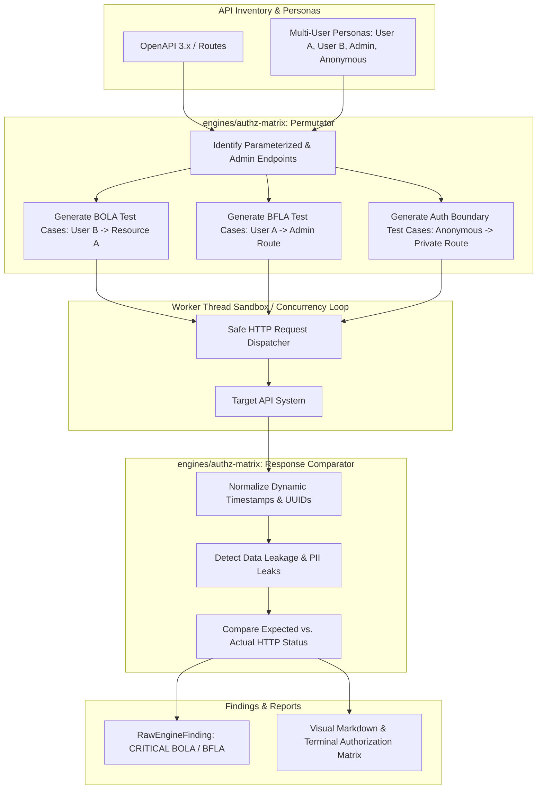

# Engine: Authorization Matrix (BOLA / BFLA Evaluation)

## 1. Overview
`@security-lab/authz-matrix` is an in-process Class A Native test engine designed to automate Broken Object-Level Authorization (BOLA / IDOR), Broken Function-Level Authorization (BFLA), and missing authentication testing across full API inventories.

Rather than relying on manually authored test cases, the engine ingests API inventories directly from OpenAPI specifications or route descriptors, automatically identifies state-reading and mutating endpoints with path parameters, and dynamically permutes access across multiple authenticated user personas (e.g. User A, User B, Admin, Anonymous).

---

## 2. Capabilities

| Capability ID | Category | Description |
|:---|:---:|:---|
| `bola_horizontal_idor` | `protocol_audit` | Permutes resource identifiers across multiple authenticated user personas to detect horizontal unauthorized data access and cross-tenant leakage. |
| `bfla_vertical_escalation` | `protocol_audit` | Replays administrative and privileged functional endpoints using low-privilege user personas to detect missing function-level access controls. |
| `auth_missing_control` | `passive_analysis` | Asserts all declared private routes enforce authentication and reject anonymous guest requests with HTTP 401 or 403. |

---

## 3. Architecture & Execution Workflow



---

## 4. Key Features

1. **Autonomous Route Parameter Discovery**:
   - Automatically detects path parameters matching `{id}`, `{userId}`, `{docId}`, `:paramName`, and queries.
   - Pairs owner personas with non-owner attacker personas to test cross-tenant object access.
2. **Dynamic Timestamp & Trace Normalization**:
   - Strips dynamic ISO-8601 dates, epoch timestamps, UUIDs, and ETags prior to evaluating response differences.
3. **Sensitive Data & PII Leakage Detection**:
   - Detects whether unauthorized responses expose sensitive keywords (`payroll`, `financial`, `ssn`, `medical`, `confidential`) or victim identifiers.
4. **Visual Authorization Matrix Report**:
   - Outputs a comprehensive route x persona permission grid directly into logs and test run metrics.
5. **Non-Destructive Safety (Rule 4 & Architecture Safety)**:
   - Prioritizes safe methods (`GET`, `HEAD`) and skips `DELETE` endpoints by default unless `allowDestructive: true` is explicitly passed.

---

## 5. Usage Example

```typescript
import { AuthzMatrixEngine } from '@security-lab/authz-matrix';
import { executeSandboxedEngine } from '@security-lab/test-runner';

const engine = new AuthzMatrixEngine();

const result = await engine.execute({
  targetUrl: 'https://api.target.local',
  options: {
    specUrl: 'https://api.target.local/openapi.json',
    personas: [
      { id: 'user_a', name: 'User A', role: 'user', token: 'token-a', resourceIds: { id: 'doc-101' } },
      { id: 'user_b', name: 'User B', role: 'user', token: 'token-b', resourceIds: { id: 'doc-102' } },
      { id: 'admin', name: 'Admin', role: 'admin', token: 'token-admin' },
      { id: 'anon', name: 'Anonymous', role: 'anonymous', isGuest: true },
    ],
  },
}, context);
```
